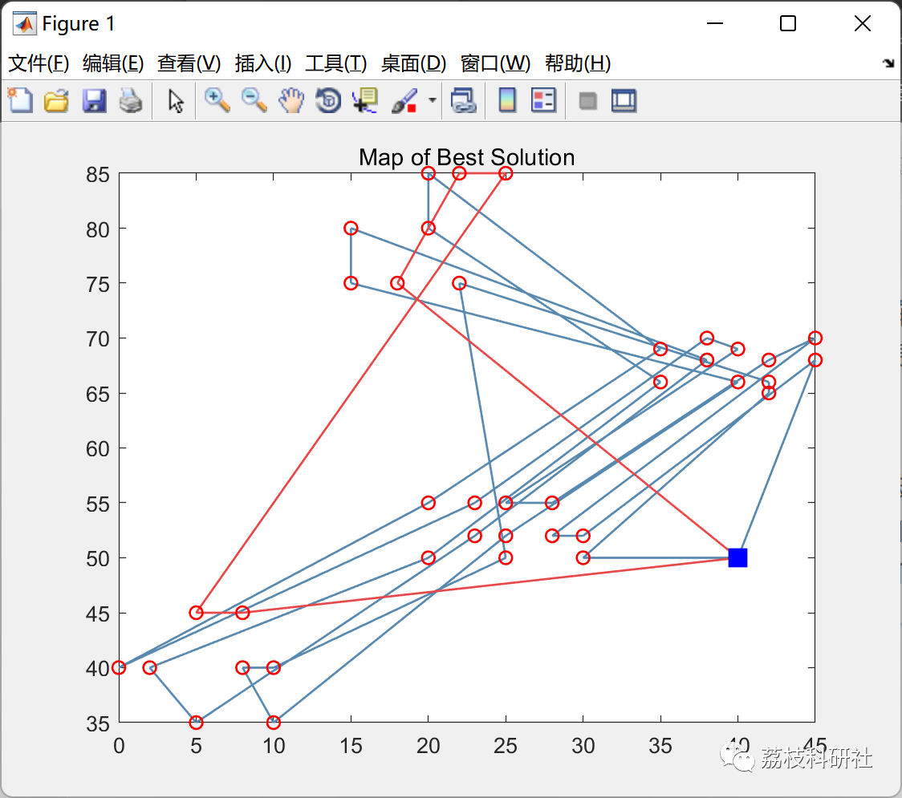
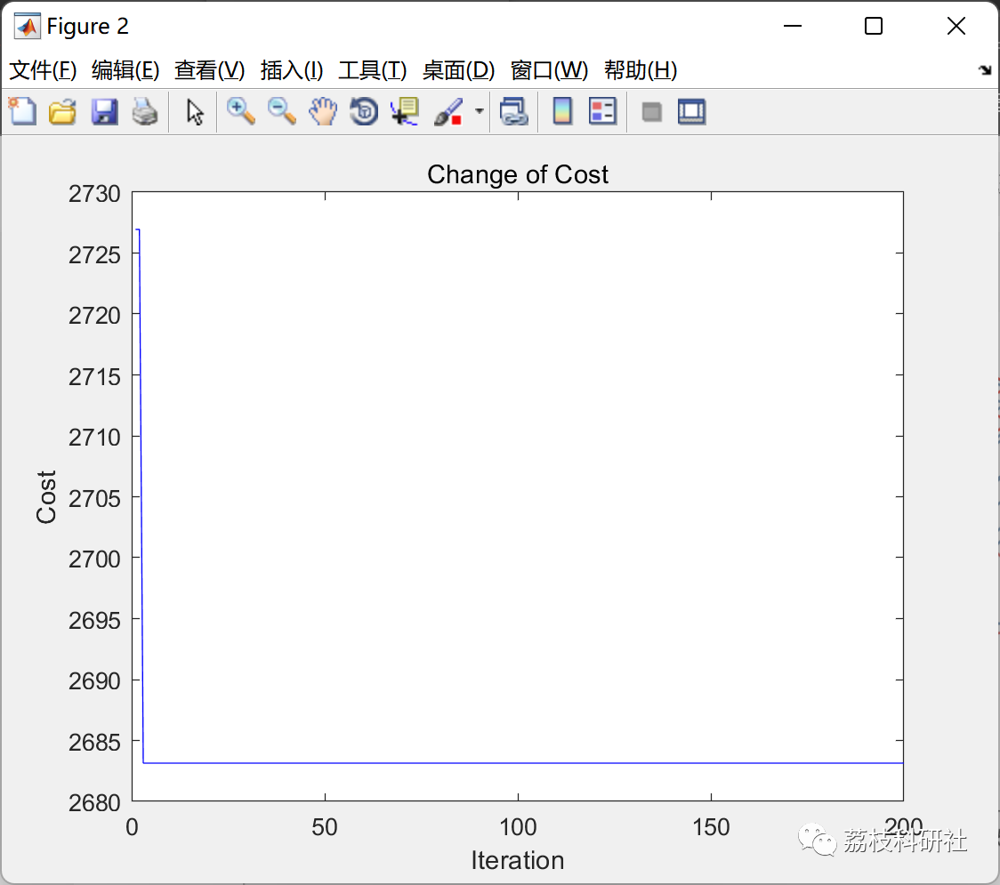

# Optimization of vehicle routing problem (VRP) based on ant colony algorithm with time window (Matlab code implementation)

💥💥💥💞💞💞💞 Welcome to this blog❤️❤️❤️💥💥💥
🏆 Bloggers' Advantage: 🌞🌞🌞 The content of the blog strives to be rigorous in thought and clear in logic, for the convenience of readers.
⛳️ Mantra: The journey of a hundred miles is half done in the last ninety.
Litchi Research Society
Code Collection: Power System, Intelligent Algorithms and Applications, Neural Network Prediction, Path Planning, Optimized Scheduling, Workshop Scheduling, Image Processing, Signal Processing...
🎁Column Directory Link:
🌈🌈🌈🌟🌟🌟🛫🛫🛫🛫🛫🛫🛫🛫🛫🛫🛫🛫🛫🛫🛫🛫🛫🛫🛫🛫🛫🛫🛫🛫🛫🛫🛫🛫🛫🛫🛫🛫🛫🛫🛫🛫🛫🛫🛫🛫🛫🛫🛫🛫🛫🛫🛫🛫🛫🛫🛫🛫🛫🛫🛫🛫🛫🛫🛫🛫🛫🛫🛫🛫🛫🛫🛫🛫🛫🛫🛫🛫🛫🛫🛫🛫🛫🛫🛫🛫🛫🛫🛫🛫🛫🛫🛫🛫🛫🛫🛫🛫🛫🛫🛫🛫🛫🛫🛫🛫🛫🛫🛫🛫🛫🛫🛫🛫🛫🛫🛫🛫🛫🛫🛫🛫🛫🛫🛫🛫🛫🛫🛫🛫🛫🛫🛫🛫🛫🛫🛫🛫🛫🛫🛫🛫🛫🛫🛫🛫🛫🛫🛫🛫🛫🛫🛫🛫🛫🛫🛫🛫🛫🛫🛫🛫🛫🛫🛫🛫🛫🛫🛫🛫🛫🛫🛫🛫🛫🛫🛫🛫🛫🛫🛫🛫🛫🛫🛫🛫🛫🛫🛫🛫🛫🛫🛫🛫🛫🛫🛫🛫🛫🛫🛫🛫🛫🛫🛫🛫🛫🛫🛫🛫🛫🛫🛫🛫🛫🛫🛫🛫🛫🛫🛫🛫🛫🛫🛫🛫🛫🛫🛫🛫🛫🛫🛫🛫🛫🛫🛫🛫🛫🛫🛫🛫🛫🛫🛫🛫🛫🛫🛫🛫🛫🛫🛫🛫🛫🛫🛫🛫🛫🛫🛫🛫
💥1 Overview
📚2 Running Results
🎉3 References
👨‍💻4 Matlab code implementation
💥1 Overview
For logistics and distribution companies, to gain a competitive edge in an intensely competitive environment, it is essential to provide high-quality services while minimizing costs. Efficient and swift goods delivery can enhance customer satisfaction and service quality. However, blindly increasing efficiency may lead to increased labor demands, transportation expenses, and vehicle requirements, ultimately leading to higher transportation costs. How to achieve cost reduction while improving the quality of logistics services and timely delivering goods to customers through rationalized transportation is a pressing issue for logistics companies.
Correctly selecting the vehicle's route and formulating a feasible vehicle delivery route plan are crucial for reducing costs. This type of problem is known as the Vehicle Routing Problem (VRP), also referred to as VRP problem. To enhance the timeliness of logistics companies, the delivery parties and receiving parties agree on a delivery window. If the delivery is delayed, the receiving party has grounds for requesting time compensation. The delivery party must pay penalties to the customer receiving the goods. This period is called the time window. Adding the time window factor to the VRP is what we call the Vehicle Routing Problem with Time Windows (VRPTW). From a theoretical perspective, the Vehicle Routing Problem with Time Windows is a complex combinatorial optimization problem, with high complexity and computational difficulty, and has been proven to be an NP-hard problem.
📚2 Running Results
🎉3 References
[1] Hu Junqiao. Ant Colony Hybrid Algorithm for Vehicle Routing Problem with Time Windows [D]. Xi'an University of Science and Technology, 2017.
[2] Wei Zhixiu. Research on Delivery Vehicle Route Optimization Problem with Time Windows Based on Improved Ant Colony Algorithm [D]. Jiangsu University, 2021.DOI:10.27170/d.cnki.gjsuu.2021.002182.
👨‍💻4 MATLAB Code Implementation
Click the article below left bottom to read more

## Images

<!-- PAYMENT_BLOCK -->

## Get this dataset

- Payment link (Stripe): [Buy now](https://buy.stripe.com/3cs8yP7sY87d0vu9AB)
- Payment QR code: 

<!-- /PAYMENT_BLOCK -->
